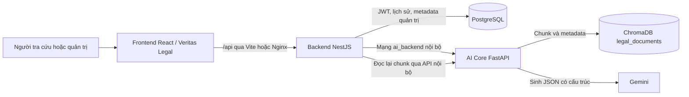
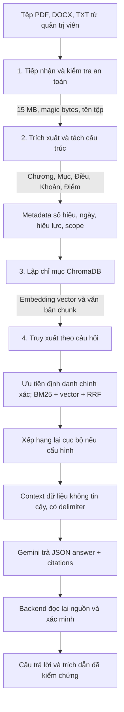

# Kiến trúc Legal Chatbot System

## 1. Ba tầng và kho dữ liệu

**Frontend** cung cấp trang công khai, khung chat đối chiếu trích dẫn, Evidence Workbench và không gian quản trị. **Backend** xử lý Auth/JWT, RBAC cho route quản trị, giới hạn 30 câu hỏi công khai trong 60 giây theo IP, lỗi an toàn, log với `requestId` và xác minh trích dẫn. **AI Core** quản lý collection `legal_documents`, tách văn bản, tìm kiếm lai và gọi Gemini. PostgreSQL lưu tài khoản, lịch sử và bảng quản trị; xác minh trích dẫn câu trả lời hiện đọc lại **ChromaDB qua endpoint nội bộ** `POST /legal/citations/verify`, rồi Backend tự đối chiếu ID, số hiệu, Điều, Khoản, URL và đoạn nguyên văn.

Trong Docker Compose, Frontend và Backend cùng mạng `frontend_backend`; Backend và AI Core cùng mạng `ai_backend`; Backend và PostgreSQL cùng mạng `db_backend`. AI Core chỉ dùng `expose: 8001`, không xuất cổng ra host. Backend được bind `127.0.0.1:3000` trên host; Frontend dùng Nginx tại cổng `8080` và chuyển `/api/` tới Backend. PostgreSQL hiện ánh xạ `5432:5432` trên host; cần giới hạn bằng tường lửa hoặc đổi thành bind loopback nếu triển khai ngoài máy phát triển.

## 2. Vòng đời dữ liệu RAG bốn chặng

### Chặng 1: tiếp nhận

`POST /legal/ingest` yêu cầu JWT vai trò `admin` và token nội bộ khi Backend chuyển sang AI Core. AI Core kiểm tra PDF có `%PDF-`, DOCX là ZIP OOXML hợp lệ, TXT UTF-8, giới hạn 15 MB, làm sạch tên tệp và loại path traversal. URL được kiểm tra giao thức, DNS và IP riêng/loopback ở endpoint URL hiện có; **luồng tải và lập chỉ mục URL chưa hoàn thiện**. Không xem một URL được bộ lọc chấp nhận là bằng chứng đã nạp.

### Chặng 2: cấu trúc và hiệu lực

Parser nhận diện Chương/Mục/Điều/Khoản/Điểm; chunk con chứa ngữ cảnh văn bản và Điều cha. Metadata gồm `doc_id`, `doc_number`, `doc_title`, `article_number`, `clause_number`, `point_id`, `effective_status`, mốc ngày, `scope`, `source_url`, `content_hash`. Bản scan hoặc văn bản OCR thiếu cấu trúc nhận `needs_review`, `chunk_count=0`; không tự cho là đã lập chỉ mục.

### Chặng 3: lập chỉ mục

AI Core lưu embedding và nguyên văn chunk trong ChromaDB tại `ai-core/chroma_db`, collection `legal_documents`. Hàm BM25 được dựng từ tập chunk đã lọc khi truy vấn, không có một kho BM25 bền vững độc lập. `content_hash` giúp tránh nạp lại cùng nội dung; không dùng thao tác xóa collection để cập nhật văn bản.

### Chặng 4: truy xuất và trả lời

Retriever lọc `scope=public` trước khi trả nguồn cho chat công khai, ưu tiên số văn bản/Điều/Khoản nêu rõ, kết hợp BM25 và vector bằng Reciprocal Rank Fusion. Cross-Encoder chỉ được dùng khi `LEGAL_RERANKER_MODEL_PATH` trỏ đến mô hình cục bộ tồn tại; nếu không, giữ thứ tự RRF. Tài liệu được bọc trong `<untrusted_legal_context>`, thẻ giả được escape và mô hình nhận system prompt riêng. Phản hồi phải là JSON `answer` và `citations`; nếu không đủ nguồn, trả lời từ chối với mảng trích dẫn rỗng. Backend đối chiếu lại từng citation trong ChromaDB. Nếu bất kỳ căn cứ nào không hợp lệ, toàn bộ câu trả lời được đổi sang lời từ chối an toàn.

## 3. Ranh giới an toàn và quyền truy cập

| Ranh giới | Cơ chế hiện có | Giới hạn cần biết |
|---|---|---|
| Trình duyệt đến Backend | JWT cho route quản trị; rate limit chat; lỗi chuẩn có `requestId` | Endpoint công khai chỉ được xem nguồn `public` |
| Backend đến AI Core | Mạng Docker nội bộ, `AI_CORE_INTERNAL_TOKEN` cho endpoint nạp và xác minh | Không công bố token hoặc lỗi nội bộ qua client |
| Nguồn tham khảo đến LLM | Lọc injection, delimiter dữ liệu không tin cậy, system prompt | Đây là biện pháp giảm rủi ro; không thay kiểm chứng Backend |
| Văn bản trong kho | `scope`, trạng thái hiệu lực, ngày, metadata cấu trúc | Trạng thái pháp lý cần được quản trị viên kiểm tra khi có sửa đổi |
| Nhật ký | Mã yêu cầu, thời gian, phương thức, mã HTTP | Không ghi body, token, nội dung tài liệu hoặc stack trace |

## 4. Tình trạng chức năng quản trị

`/admin/ingest` hiện là giao diện mô phỏng, chưa gọi API nạp. Luồng **tệp qua `POST /legal/ingest`** đã xử lý lập chỉ mục. Các route cũ `/chat/upload`, `/chat/ingest-url`, `/chat/ingest-html` hoặc AI Core `/upload`, `/ingest-url`, `/ingest-html` chưa tạo chunk và có thể trả `501` hoặc lỗi tương đương. Xem [hướng dẫn nạp dữ liệu](DATA_INGEST_GUIDE.md) để dùng đúng endpoint hoạt động.
