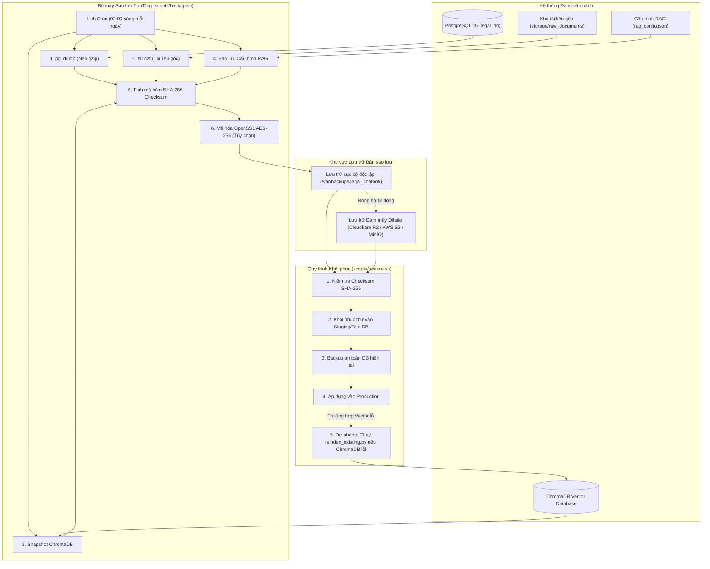

# Báo cáo Khảo sát và Đề xuất Kiến trúc Hệ thống Backup cho Chatbot Tra cứu Pháp luật

Tài liệu này tổng hợp kết quả khảo sát thực tế toàn bộ hệ thống Chatbot Tra cứu Pháp luật (Veritas Legal), phân loại các nhóm dữ liệu và đề xuất kiến trúc sao lưu (backup), bảo vệ dữ liệu và khôi phục (restore) toàn diện nhằm đảm bảo khả năng phục hồi sau thảm họa với chi phí tối ưu.

---

## 1. Kết quả Khảo sát Toàn diện Hệ thống (Giai đoạn 1)

### 1.1. Ngôn ngữ, Framework và Hạ tầng

- **Frontend:**
  - Ngôn ngữ & Framework: TypeScript, React 18, Vite.
  - Thư viện giao diện: Tailwind CSS v4, Lucide Icons.
  - Web Server: Nginx (Container `legal_frontend`, chuyển tiếp `/api` sang Backend).
- **Backend:**
  - Ngôn ngữ & Framework: TypeScript, Node.js 20, NestJS.
  - ORM & Driver: TypeORM, `pg` driver.
  - Bảo mật: Passport JWT, bcrypt, Rate limiting, RBAC (phân quyền Admin / Staff).
  - Cổng dịch vụ: 3000 (Container `legal_backend`).
- **AI Core:**
  - Ngôn ngữ & Framework: Python 3.10+, FastAPI, Uvicorn, Pydantic v2.
  - Cổng dịch vụ: 8001 (Container `legal_ai_core`, giao tiếp nội bộ qua `AI_CORE_INTERNAL_TOKEN`).
- **Hạ tầng Container:**
  - Docker Compose với 4 dịch vụ: `db`, `ai-core`, `backend`, `frontend`.
  - Phân tách mạng an toàn: `db_backend`, `ai_backend`, `frontend_backend`.

### 1.2. Cơ sở dữ liệu Quan hệ (Relational Database)

- **Công nghệ:** PostgreSQL 15-alpine (Container `legal_db`, volume `postgres_data`).
- **Quy mô dữ liệu hiện tại (thực tế kiểm tra):**
  - `users`: 6 tài khoản người dùng và quản trị viên.
  - `chat_history`: 118 tin nhắn hội thoại tra cứu.
  - `legal_documents`: 10 văn bản quy phạm pháp luật (Luật Lao động 2019, Luật Doanh nghiệp 2020, Nghị định Tây Ninh 72/2025/QH15, Nghị định 13/2023/NĐ-CP, Chuyên đề CD-01, Nghị định 312/2026/NĐ-CP, Nghị định 999/2026/NĐ-CP, Luật Trật tự ATGT đường bộ 36/2024/QH15, Nghị định 168/2024/NĐ-CP).
  - `legal_articles`: 1.310 đơn vị cấu trúc phân cấp (Điều, Khoản, Điểm) lưu trữ toàn văn văn bản gốc (`original_text`).
  - `ingestion_jobs`: 21 bản ghi công việc nạp văn bản, lưu trữ toàn bộ `payload` JSONB của từng tài liệu.
  - `conversation_reviews`: Bảng lưu trữ đánh giá rà soát chất lượng câu trả lời của quản trị viên.
  - `model_config`: Bảng lưu cấu hình khóa mã hóa LLM.
  - `auth_challenges`, `auth_rate_limits`, `schema_migrations`: Các bảng quản lý bảo mật xác thực và phiên bản schema.

### 1.3. Cơ sở dữ liệu Vector (Vector Database)

- **Công nghệ:** ChromaDB v0.5+ (Persistent Client).
- **Vị trí lưu trữ:** Thư mục `ai-core/chroma_db/` (gắn volume container vào `./ai-core/chroma_db`).
- **Thành phần vật lý:**
  - File siêu dữ liệu SQLite: `chroma.sqlite3` (khoảng 19.2 MB).
  - Các thư mục chỉ mục phân đoạn nhị phân (Segment UUIDs).
- **Quy mô hiện tại:**
  - Collection chính: `legal_documents`.
  - Tổng số vector embeddings: 878 vectors.
  - Tổng số dòng siêu dữ liệu: 18.387 dòng metadata.

### 1.4. Công nghệ Embedding và Mô hình AI

- **Embedding:** Google Gemini `text-embedding-004` (độ dài vector cố định 768 chiều). Có cơ chế dự phòng `DefaultEmbeddingFunction` (384 chiều) trong môi trường kiểm thử unit test.
- **LLM:** Google Gemini `gemini-2.5-flash-lite` với cơ chế tự động chuyển đổi dự phòng khi quá tải (Fallback: `gemini-2.5-flash` -> `gemini-2.0-flash`).
- **Cấu hình RAG & Prompt:**
  - File cấu hình: `ai-core/rag_config.json` (System prompt, temperature=0, top_p=0.9, max_tokens=2048).
  - Cấu hình nạp động: `ai-core/legal/runtime_config.py`.
  - Thuật toán truy xuất: Hybrid Search 3-Tier (Khớp chính xác Điều/Khoản/Điểm, BM25 Bigram + Từ điển đồng nghĩa pháp lý, Vector similarity 768d, Lightweight Legal Reranker, 1-Hop Cross-Reference Expansion và Sibling Context Grouping).

### 1.5. Nơi lưu trữ Tài liệu Gốc và Điểm nghẽn cần bổ sung

- **Luồng nạp dữ liệu hiện tại:**
  1. Người dùng/Admin tải tệp PDF, DOCX, TXT hoặc nhập URL công khai qua endpoint `/legal/ingest` hoặc `/legal/ingest-url`.
  2. Backend gửi luồng nhị phân (Buffer) sang AI Core `/legal/ingest`.
  3. AI Core đọc byte vào RAM, tính hàm băm SHA-256 (`content_hash`), bóc tách text sang cây cấu trúc `units`, chia chunks và lập chỉ mục vào ChromaDB.
  4. Backend nhận phản hồi và lưu toàn bộ thông tin vào PostgreSQL:
     - Toàn bộ cây Điều/Khoản kèm văn bản nguyên văn (`original_text`) lưu vào bảng `legal_articles`.
     - Toàn bộ cấu trúc metadata và dữ liệu phân đoạn lưu vào trường `payload` (JSONB) của bảng `ingestion_jobs`.
     - Siêu dữ liệu tài liệu lưu vào bảng `legal_documents`.
- **Phát hiện quan trọng:** Tệp nhị phân gốc (.pdf, .docx) chưa được ghi bền vững ra một thư mục lưu trữ tệp vật lý độc lập (`storage/raw_documents/`). Do đó, cần bổ sung cơ chế lưu trữ tệp nhị phân gốc theo mã băm SHA-256 để đáp ứng trọn vẹn yêu cầu bảo toàn tài liệu gốc của hệ thống.

---

## 2. Phân loại Dữ liệu Hệ thống (Giai đoạn 2)

Dữ liệu của hệ thống Chatbot Tra cứu Pháp luật được phân loại thành 3 nhóm:

### 2.1. Nhóm 1: Dữ liệu BẮT BUỘC PHẢI BACKUP (Không thể tái tạo nếu mất)

1. **Cơ sở dữ liệu quan hệ PostgreSQL (`legal_db`):**
   - Tài khoản người dùng, vai trò quản trị, thông tin bảo mật 2FA/OTP (`users`).
   - Toàn bộ lịch sử trao đổi, hỏi đáp của người dùng (`chat_history`).
   - Lịch sử đánh giá, rà soát của chuyên viên pháp lý (`conversation_reviews`).
   - Danh mục văn bản pháp luật, ngày ban hành, phạm vi công khai/nội bộ (`legal_documents`).
   - Toàn văn nguyên văn của các Điều, Khoản, Điểm sau khi đã được chuẩn hóa và kiểm duyệt (`legal_articles`).
   - Lịch sử các đợt nạp văn bản kèm payload gốc (`ingestion_jobs`).
2. **Kho tệp tài liệu pháp luật gốc (Binary Files):**
   - Các tệp PDF, DOCX, DOC, TXT do quản trị viên tải lên hệ thống.
   - Định danh tệp gắn liền với mã băm `content_hash` và số hiệu văn bản.
3. **Cấu hình AI, Prompt và Tham số Chatbot:**
   - File cấu hình RAG: `ai-core/rag_config.json`.
   - File mẫu môi trường: `.env.example` và cấu hình triển khai `docker-compose.yml`.
   - Khóa cấu hình và prompt hệ thống trong mã nguồn.

### 2.2. Nhóm 2: Dữ liệu CÓ THỂ TÁI TẠO từ dữ liệu gốc

1. **ChromaDB Vector Database (`ai-core/chroma_db/`):**
   - Các vector embeddings 768 chiều và các đoạn chunks văn bản.
   - **Khả năng tái tạo:** Vì toàn bộ văn bản nguyên văn `original_text` và metadata Điều/Khoản đã được lưu trong bảng PostgreSQL `legal_articles`, hệ thống có sẵn script `ai-core/scripts/reindex_existing.py` để tái lập toàn bộ chỉ mục ChromaDB mà không cần gọi lại OCR.
   - **Chiến lược:** Mặc dù có thể tái tạo, hệ thống VẪN BACKUP định kỳ snapshot ChromaDB (`chroma.sqlite3` và thư mục phân đoạn) để đảm bảo thời gian phục hồi nhanh (RTO < 5 phút) mà không phụ thuộc vào kết nối mạng hay hạn mức Gemini Embedding API.

### 2.3. Nhóm 3: Dữ liệu TẠM THỜI (Không cần backup)

- Thư mục tệp tạm thời trong phiên xử lý: `ai-core/temp_uploads/`.
- Thư mục thư viện và cache biên dịch: `node_modules/`, `venv/`, `__pycache__/`, `.pytest_cache/`, `dist/`.
- Bảng tạm giới hạn tần suất yêu cầu: `auth_rate_limits`, `auth_challenges`.
- File log hoạt động ứng dụng: `backend/backend.log`, log runtime container Docker.

---

## 3. Kiến trúc Hệ thống Sao lưu Đề xuất (Giai đoạn 3)

### Các nguyên tắc kỹ thuật cốt lõi:

1. **Không gián đoạn dịch vụ (Zero-Downtime):**
   - Sử dụng `pg_dump` với cơ chế cô lập MVCC của PostgreSQL, không khóa bảng, người dùng tra cứu bình thường trong khi backup.
   - Sao lưu ChromaDB ở trạng thái nhất quán thông qua bản sao SQLite.
2. **Chi phí 0 đồng tiền bản quyền phần mềm:**
   - Tận dụng 100% công cụ mã nguồn mở tiêu chuẩn: `pg_dump`, `tar`, `gzip`, `sha256sum`, `openssl`, `cron`.
3. **Lưu trữ Offsite độc lập với chi phí tối thiểu:**
   - Đề xuất đồng bộ bản sao lưu sang **Cloudflare R2** (miễn phí 10 GB lưu trữ đầu tiên mỗi tháng, hoàn toàn miễn phí băng thông truyền tải dữ liệu Egress) hoặc MinIO / AWS S3 / Remote VPS qua SFTP.
4. **Bảo mật và Mã hóa bản sao lưu:**
   - Bản sao lưu được nén định dạng `.tar.gz`.
   - Hỗ trợ mã hóa đối xứng AES-256-CBC qua OpenSSL trước khi gửi lên dịch vụ lưu trữ đám mây.
   - Tuyệt đối không lưu mật khẩu hoặc API Key dưới dạng văn bản thuần trong file backup.
5. **Kiểm tra tính toàn vẹn (Integrity Check):**
   - Mọi tệp backup đều tự động sinh tệp checksum `.sha256`. Trước khi thực hiện restore, hệ thống bắt buộc kiểm tra mã băm để phát hiện tệp bị lỗi hoặc hư hại đường truyền.

---

## 4. Chính sách Lưu trữ Bản sao lưu (Giai đoạn 4)

Thiết lập cơ chế xoay vòng tự động (Retention Policy) theo mô hình chuẩn Grandfather-Father-Son (GFS):

- **Bản sao lưu hằng ngày (Daily Backups):**
  - Tần suất: Chạy vào lúc 02:00 sáng mỗi ngày.
  - Thời gian lưu trữ: Lưu trong **30 ngày** gần nhất.
- **Bản sao lưu hằng tuần (Weekly Backups):**
  - Tần suất: Lấy bản sao lưu ngày Chủ nhật hằng tuần.
  - Thời gian lưu trữ: Lưu trong **8 tuần**.
- **Bản sao lưu hằng tháng (Monthly Backups):**
  - Tần suất: Lấy bản sao lưu ngày đầu tiên của mỗi tháng.
  - Thời gian lưu trữ: Lưu trong **6 tháng**.
- **Tài liệu pháp luật gốc:**
  - Lưu trữ lâu dài, không xóa tự động kể cả khi đã bóc tách xong text và tạo embedding.
- **Quy tắc an toàn bản sao lưu:**
  - Bản sao lưu mới phải hoàn thành và vượt qua kiểm tra mã băm SHA-256 thành công thì script dọn dẹp mới được phép xóa bản sao lưu cũ quá hạn.

---

## 5. Quy trình Khôi phục Dữ liệu (Giai đoạn 5)

Hệ thống khôi phục được thiết kế theo 5 bước tuần tự, có kiểm soát rủi ro:

1. **Bước 1 - Xác minh bản sao lưu:**
   - Chạy lệnh `sha256sum -c <backup_file>.sha256` để kiểm tra toàn vẹn gói dữ liệu.
   - Giải nén gói backup vào thư mục tạm thời.
2. **Bước 2 - Sao lưu an toàn trạng thái hiện tại (Safety Snapshot):**
   - Trước khi ghi đè bất kỳ dữ liệu nào vào production, hệ thống tự động chụp nhanh trạng thái PostgreSQL và ChromaDB hiện tại để có thể rollback tức thì nếu có sự cố.
3. **Bước 3 - Khôi phục cơ sở dữ liệu quan hệ:**
   - Khôi phục PostgreSQL từ bản dump `.sql.gz` thông qua lệnh `pg_restore` hoặc `psql`.
   - Xác nhận 10 bảng nghiệp vụ đã có đủ dữ liệu.
4. **Bước 4 - Khôi phục kho tài liệu gốc và Vector Database:**
   - Giải nén kho tài liệu gốc vào `storage/raw_documents/`.
   - Khôi phục snapshot ChromaDB vào `ai-core/chroma_db/`.
   - *Phương án dự phòng:* Nếu snapshot ChromaDB bị lỗi phân đoạn, kích hoạt script `ai-core/scripts/reindex_existing.py` để đọc 1.310 đơn vị Điều/Khoản trong PostgreSQL và sinh lại bộ vector 768 chiều hoàn chỉnh.
5. **Bước 5 - Kiểm tra nghiệp vụ sau khôi phục (Smoke Test):**
   - Đặt câu hỏi tra cứu kiểm thử thực tế qua API hoặc UI (ví dụ: *"Điều kiện thành lập công ty TNHH theo Luật Doanh nghiệp 2020"*).
   - Xác nhận câu trả lời có đầy đủ nội dung và trích dẫn thẻ nguồn chính xác đến văn bản gốc.

---

## 6. Kế hoạch Triển khai Chi tiết

1. **Tạo thư mục kho tài liệu gốc:** Thiết lập `storage/raw_documents/` và cập nhật luồng tiếp nhận file tải lên để lưu trữ file nhị phân nguyên bản.
2. **Viết script sao lưu tự động `scripts/backup.sh`:**
   - Thực hiện dump database, copy tài liệu gốc, snapshot ChromaDB, nén tệp theo ngày giờ, tính SHA-256 và dọn dẹp bản sao lưu quá hạn theo chính sách retention.
3. **Viết script khôi phục `scripts/restore.sh`:**
   - Thực hiện kiểm tra tính toàn vẹn, hỗ trợ khôi phục từng phần hoặc toàn bộ hệ thống, hỗ trợ chế độ dry-run/staging test.
4. **Thiết lập Cron Job / Systemd Timer:**
   - Lập lịch chạy tự động hằng ngày vào 02:00 sáng.
5. **Kiểm thử khôi phục thực tế (Disaster Recovery Simulation):**
   - Mô phỏng sự cố mất dữ liệu trên môi trường test -> thực hiện restore -> kiểm thử chatbot tra cứu chính xác.
6. **Bàn giao tài liệu hướng dẫn vận hành `docs/BACKUP_GUIDE.md`:**
   - Hướng dẫn vận hành sao lưu thủ công, tự động, theo dõi log và quy trình xử lý sự cố.

---
*Tài liệu được khởi tạo và lưu trữ tại `docs/BACKUP_SYSTEM_PROPOSAL.md` theo quy trình chuẩn của Veritas Legal System.*
